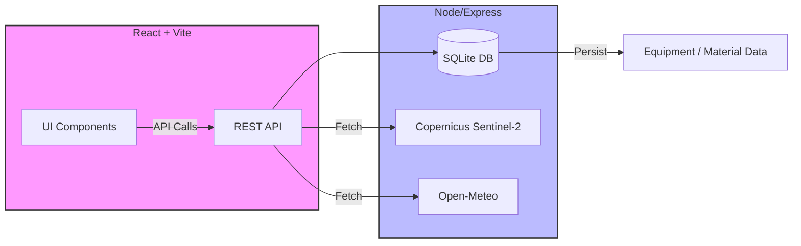

# MnIntel AI – Mining Intelligence Dashboard


---

## Overview

**MnIntel AI** is a web‑based mining intelligence platform that aggregates satellite imagery, weather forecasts, and equipment utilization data to help mining operators make data‑driven decisions. The dashboard visualises material‑wise equipment allocation, predicts demand‑capacity gaps, and offers actionable insights for operational efficiency.

---

## Key Features

- **Dynamic Equipment Allocation** – View and adjust equipment distribution per material (e.g., ore, waste) in real‑time.
- **Satellite Data Integration** – Pulls Copernicus Sentinel‑2 imagery to monitor site changes.
- **Weather Forecasts** – Uses Open‑Meteo to overlay weather conditions affecting operations.
- **Interactive Charts** – Recharts‑based graphs for utilization, demand, and predictive maintenance.
- **Backend API** – Express server exposing CRUD endpoints for equipment, material, and weather data.
- **Deployment Ready** – Frontend hosted on Vercel, backend reachable via Cloudflare tunnel (or any Node host).

---

## Architecture



---

## Tech Stack

| Layer | Technology |
|-------|------------|
| Frontend | React, TypeScript, Vite, TailwindCSS, Recharts, lucide‑react |
| Backend | Node.js, Express, TypeScript, SQLite |
| Data Sources | Copernicus Sentinel‑2 API, Open‑Meteo API |
| Deployment | Vercel (frontend), Cloudflare Tunnel / any Node host (backend) |

---

## Getting Started

```bash
# Clone the repository
git clone https://github.com/jayadharshanram-ship-it/MnintelAI.git
cd MnintelAI

# Install dependencies
npm install

# Prepare environment variables
cp .env.example .env   # edit .env with your keys

# Run the backend API (default port 5000)
npm run dev:backend

# In a new terminal, start the frontend
npm run dev
```

The frontend will be served at `http://localhost:5173` and expects the backend API at the URL defined by `VITE_API_BASE_URL` in `.env`.

---

## Environment Variables

| Variable | Description |
|----------|-------------|
| `VITE_API_BASE_URL` | Base URL of the backend API (e.g., `http://localhost:5000/api`). |
| `COPERNICUS_CLIENT_ID` | Client ID for Copernicus API access. |
| `COPERNICUS_CLIENT_SECRET` | Client secret for Copernicus API. |
| `OPEN_METEO_API_URL` | (Optional) Override Open‑Meteo endpoint. |

> **Note:** Do **not** commit the populated `.env` file. Only `.env.example` is tracked.

---

## Deployment

1. **Frontend** – Connect the repo to Vercel (or any static site host). Vercel will automatically run `npm run build`.
2. **Backend** – Deploy to a Node‑compatible platform (e.g., Render, Railway, or a Cloudflare worker). Ensure the environment variables above are set in the hosting service.
3. **Domain** – Update `VITE_API_BASE_URL` in the Vercel project settings to point to your deployed backend.

---

## Contributing

1. Fork the repository.
2. Create a feature branch: `git checkout -b feature/your-feature`.
3. Make your changes, ensuring the code builds with `npm run lint` and `npm run test` (if tests exist).
4. Submit a Pull Request with a clear description.
5. Keep `.env.example` up‑to‑date with any new variables.

---

## License

This project is licensed under the **MIT License** – see the [LICENSE](LICENSE) file for details.

---

## Contact

For questions or suggestions, open an issue on GitHub or contact the maintainer at `jayadharshanram-ship-it@github.com`.
